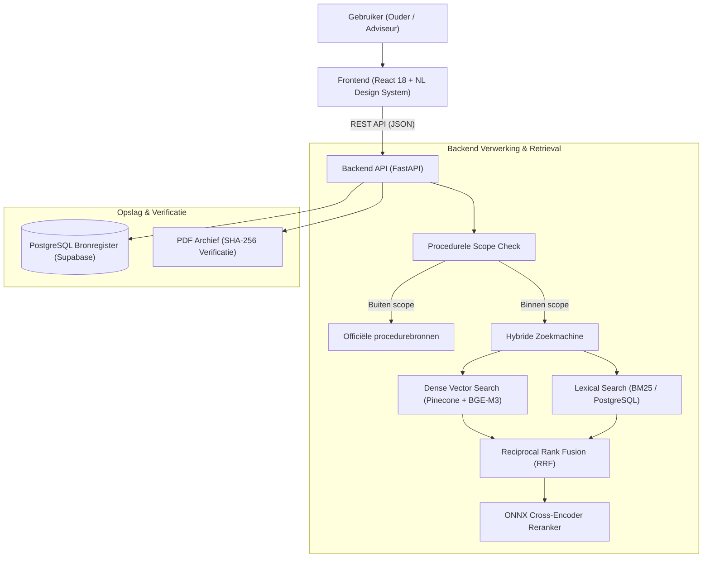

# Architectuur & Technisch Ontwerp — SchoolRecht

SchoolRecht is een LegalTech-zoekplatform en bronregister voor uitspraken van de **Geschillencommissie Passend Onderwijs (GPO)**. Het systeem stelt ouders, scholen en juridisch adviseurs in staat om openbare oordelen te doorzoeken op basis van alledaagse hulpvragen, met strikte garanties tegen hallucinaties via cryptografisch geverifieerde broncitaten.

---

## 1. Systeemoverzicht

Het platform bestaat uit vier ontkoppelde componenten:

---

## 2. Componenten in Detail

### 2.1 Frontend (`gpo-assistent/frontend`)
- **Framework:** React 18 met Vite en TypeScript.
- **Design Systeem:** NL Design System (`@nl-design-system-candidate/*`) en Utrecht Component Library/Design Tokens. Hiermee voldoet de gebruikersinterface aan de officiële overheidsrichtlijnen voor digitale toegankelijkheid (WCAG 2.1 AA).
- **Kerncomponenten:**
  - `ZaakvergelijkerPage`: Zoekbalk met dynamische suggesties en filteropties op onderwijssector (PO/VO) en thema.
  - `CaseCard`: Compacte weergave van een gevonden zaak, inclusief datum, oordeel van de Commissie en kernoverweging.
  - `CitationDrawer`: Toegankelijk zijpaneel waarin het letterlijke citaat wordt getoond met paginanummer en de exacte positie in de originele PDF.

### 2.2 Backend API (`gpo-assistent/backend/gpo_app`)
- **Framework:** Python 3.11+ met FastAPI en Pydantic v2.
- **ORM & Migraties:** SQLAlchemy 2.0 met Alembic voor versioned schema management.
- **Principes:**
  - *Data bij de Bron:* Geen vrije samenvattingen door taalmodellen; alle getoonde overwegingen zijn letterlijke citaten uit het geregistreerde brondocument.
  - *Stateless REST:* Eenvoudig horizontaal schaalbaar en containerised met Docker.

### 2.3 Broningestie & Cryptografische Validatie (`gpo-assistent/backend/gpo_local`)
- **PDF-Parsing:** Extractie van paginagewijze tekst met `pypdf`.
- **Integriteitscontrole:** Elk document wordt gehasht met `SHA-256`. Wijzigingen in brondocumenten maken bestaande extracties ongeldig.
- **Sectie-Indeling:** De tekst wordt opgedeeld in functionele categorieën:
  1. *Feiten en voorgeschiedenis*
  2. *Standpunt van verzoeker (ouders)*
  3. *Standpunt van verweerder (schoolbestuur)*
  4. *Overwegingen van de Commissie (beoordeling)*
  5. *Dictum (oordeel: gegrond / ongegrond)*
- **Citaatregistratie:** Zinnen binnen de commissieoverwegingen krijgen unieke `source_id`'s met exacte begin- en eindkarakterposities (`char_start`, `char_end`) op de fysieke pagina.

### 2.4 Hybride Zoekmachine (`gpo-assistent/backend/gpo_app/pinecone_search.py`)
1. **Oudertaal Mapping:** Zoekvragen zoals *"klas zit vol"* of *"school weigert extra begeleiding"* worden verwerkt zonder dat de gebruiker formele juridische termen hoeft te kennen (zoals *"zorgplicht art. 40 lid 4 WPO"*).
2. **Dense Vector Retrieval:** Vragen worden omgezet in 1024-dimensionale embeddings via `BAAI/bge-m3` en opgevraagd via Pinecone.
3. **Lexicale Retrieval:** Parallelle BM25 ranking over historische commissiepassages.
4. **Reciprocal Rank Fusion (RRF):** Combineert de ranglijsten van beide methoden:
   $$\text{RRF Score}(d) = \sum_{m \in \{\text{dense}, \text{lexical}\}} \frac{1}{60 + r_m(d)}$$
5. **Cross-Encoder Reranking:** Lokale ONNX Cross-Encoder scoort de top-kandidaten op semantische relevantie voor de specifieke vraag.

---

## 3. Veiligheid en Procedurele Begrenzing

SchoolRecht beschermt gebruikers tegen verkeerde aannames:
- **Scope-bewaking:** Vragen over lopende termijnen, beroepsmogelijkheden of schadevergoeding worden vóór de zoekopdracht afgevangen. De gebruiker krijgt direct een doorverwijzing naar de bevoegde instantie (zoals de Onderwijsconsulenten of de rechtbank).
- **Geen hallucinaties:** Omdat SchoolRecht uitsluitend extractief werkt, kan het systeem geen feiten of overwegingen verzinnen die niet in de originele uitspraak staan.
